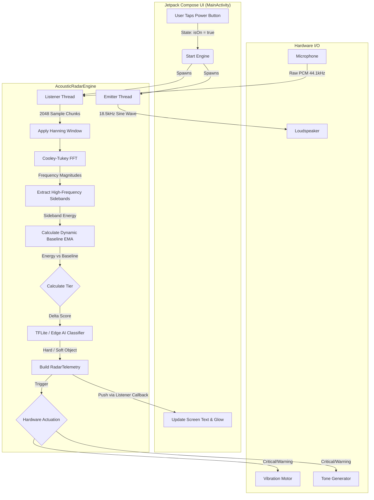

# EchoPath Acoustic Radar (Workspace)

Welcome to the EchoPath workspace! This directory contains the complete source code for the EchoPath Android application.

## 📂 Project Structure

This workspace contains the merged codebase of the UI and the Digital Signal Processing (DSP) Engine.

*   **[`EchoPathUI/`](./EchoPathUI)** - **Main Android Application (Use This!)**
    *   This folder contains the fully integrated, production-ready Android Studio project. It combines your custom Jetpack Compose UI with the high-frequency Acoustic Radar Engine. 
    *   **To run the app:** Open the `EchoPathUI` folder directly in Android Studio and hit Run.
*   **[`app/`](./app)** - *Legacy/Standalone Engine (Depreciated)*
    *   This folder contains the original, headless Kotlin engine we built before integrating it with your UI. You can ignore this folder, as all the logic has been successfully merged into `EchoPathUI`.

---

## 🛠️ Complete Tech Stack

### Core Application
- **Language:** Kotlin
- **Platform:** Native Android (Min SDK: 26, Target SDK: 35)
- **UI Toolkit:** Jetpack Compose (Material 3)
- **State Management:** Compose `State<T>`, `LaunchedEffect`

### DSP & Acoustic Engine
- **Audio Capture:** `AudioRecord` (Raw PCM 16-bit, `UNPROCESSED` source to bypass OS noise cancellation)
- **Audio Emission:** `AudioTrack` (18.5kHz continuous carrier sine wave)
- **Mathematics:** Custom Cooley-Tukey Fast Fourier Transform (FFT) algorithm for real-time frequency domain conversion.

### Edge ML & AI
- **Framework:** TensorFlow Lite (`org.tensorflow:tensorflow-lite:2.14.0`)
- **Current Model:** Heuristic Sideband Dispersion Classifier (Placeholder for 1D-CNN)

### Hardware Actuation
- **Haptics:** Android `Vibrator` & `VibratorManager` (Dynamic waveform pulsing)
- **Alerts:** `ToneGenerator` (Low-latency hardware beeps: `TONE_CDMA_URGENT`, `TONE_PROP_BEEP`)
- **Voice:** `TextToSpeech` (TTS) Engine

---

## 🔄 System Flowchart

Here is the exact runtime data flow showing how the UI, sensors, math, and AI all interact in real-time.

