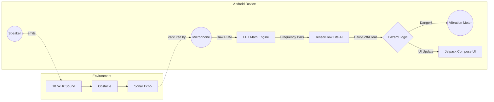

<div align="center">

# 🦇 EchoPath

### Turn any Android phone into a sonar. See with sound.

*An offline, edge-AI acoustic radar that helps people sense obstacles using only the hardware already in their pocket.*


</div>

---

## 🚀 The Big Idea

How do you give people, especially the **visually impaired**, a reliable way to sense obstacles around them using *only* a smartphone? No lidar. No extra gadgets. No internet.

**Our answer: Acoustic Radar (Sonar).**

EchoPath makes your phone behave like a bat 🦇. It sends out sound, listens for the echoes, and tells you through vibration and audio cues when something is in your way.

### ✨ Why it's cool

| | |
|---|---|
| 📴 **100% Offline** | Everything runs on the device. No cloud, no data usage. |
| 🧠 **Edge AI** | A TensorFlow Lite model classifies what's ahead in real time. |
| ⚡ **Near-zero latency** | Fast enough to matter when you're walking. |
| 🔇 **Barely audible** | Uses a high-frequency 18.5 kHz tone that's hard to hear. |
| 📳 **Instant haptics** | Vibration + tone warnings the moment danger is detected. |
| 🛠️ **No extra hardware** | Just the speaker and microphone your phone already has. |

---

## 🎯 How It Works

The concept is simple, but the math gets wild:

1. 🔊 The app plays a continuous **18.5 kHz sine wave** through the phone's loudspeaker.
2. 🎙️ The microphone records the environment while the sound plays.
3. 🧱 When the waves hit an object (a wall, a person, a parked car), they **bounce back** to the mic.
4. 📈 A **custom Fast Fourier Transform (FFT)** isolates the echoes from the raw audio.
5. 🚨 If the echoes cross a **dynamic baseline**, the phone instantly triggers **haptic feedback and audio warnings**.

### 🧠 The Brains: Edge AI

We don't just look at volume. The FFT output is fed into a local **TensorFlow Lite** model that studies the *signature* of the bounce and classifies what's ahead:

| Class | Example |
|-------|---------|
| 🧊 **Hard Surface** | Glass door, wall |
| 🧍 **Soft Object** | A person |
| ✅ **Clear** | Nothing in the way |

Because inference happens on the edge, latency is practically zero.

---

## 🏗️ Architecture



---

## 🧰 Tech Stack

Minimal dependencies, mostly raw math and native Android APIs.

| Layer | Technology |
|-------|-----------|
| **Language** | Kotlin (100%) |
| **UI** | Jetpack Compose (modern, reactive, clean) |
| **Audio I/O** | `AudioRecord` (with the `UNPROCESSED` source to bypass OS noise cancellation) and `AudioTrack` |
| **Signal Processing** | Custom **Cooley-Tukey FFT** written from scratch, so no heavy C++ math libraries |
| **AI Inference** | TensorFlow Lite Android SDK |
| **Actuation** | `VibratorManager` and `ToneGenerator` for zero-lag physical feedback |
| **Model Training** | Python (`train_acoustic_model.py`) |

---

## 📁 Project Structure

```
TECHASHY_NEW_PS/
├── EchoPathUI/                  # ✅ The fully integrated Android app (open this one!)
├── app/                         # Early app module (superseded by EchoPathUI)
├── datasets/                    # Acoustic data used to train the classifier
├── train_acoustic_model.py      # Trains the acoustic classification model
├── tech_stack_and_flowchart.md  # Extra notes on the tech stack and flow
├── build.gradle
├── settings.gradle
└── README.md
```

> ⚠️ **Heads up:** open the **`EchoPathUI`** folder in Android Studio and ignore the root `app` folder. `EchoPathUI` contains the complete app.

---

## ⚙️ Getting Started

### Prerequisites

- [Android Studio](https://developer.android.com/studio) (latest stable)
- An Android phone with a working speaker and microphone
- A USB cable with USB debugging enabled on the phone

### Run the app

1. **Clone the repo**
   ```bash
   git clone https://github.com/anishraj9789/TECHASHY_NEW_PS.git
   ```
2. **Open** the `EchoPathUI` folder in Android Studio.
3. **Wait** for Gradle sync to finish.
4. **Connect** your Android phone via USB.
5. Hit **▶ Run**.

> 🎙️ **Important:** grant **Microphone permission** when the app opens. Without it, EchoPath can't listen for the echoes.

### (Optional) Retrain the model

```bash
pip install tensorflow numpy
python train_acoustic_model.py
```

*Check the script for the exact dataset paths and any extra dependencies it needs.*

---

## 💡 Tips for Best Results

- 📱 Hold the phone steady, with the speaker and mic facing forward.
- 🧼 Don't cover the speaker or microphone with your hand or a thick case.
- 🔉 Use it in reasonably quiet surroundings for cleaner echoes.
- 📵 Phones with aggressive hardware noise filtering may respond differently. Results can vary by device.

---

## 🛣️ Roadmap

- [ ] Distance estimation, not just presence detection
- [ ] Directional sensing (left / right / ahead)
- [ ] Voice guidance in multiple languages
- [ ] Larger and more diverse training dataset
- [ ] Battery and performance optimizations

