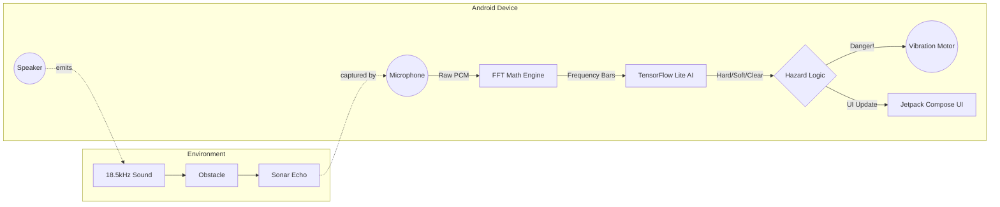

# EchoPath 🦇

Hey there! Welcome to EchoPath.

We built EchoPath to solve a really tricky problem: how do you give people (especially the visually impaired) a reliable way to sense obstacles around them using *only* the hardware they already have in their pockets?

Our answer? **Acoustic Radar (Sonar)**. 

EchoPath turns any standard Android smartphone into an active sonar device. It works entirely offline, processes everything on the edge, and doesn't require any extra hardware, lidar, or internet connection.

## How it Actually Works

The concept is surprisingly simple, but the math gets a bit wild:
1. The app blasts a high-frequency continuous sine wave (18.5kHz) out of the phone's loudspeaker. You can barely hear it, if at all.
2. The phone's microphone records the environment while this sound is playing.
3. When the sound waves hit an object (like a wall, a person, or a parked car), they bounce back and hit the microphone. 
4. We run a custom Fast Fourier Transform (FFT) on the raw audio to isolate the echoes.
5. If the echoes cross our dynamic baseline, the phone instantly triggers haptic feedback (vibrations) and audio warnings.

### The Brains: Edge AI
We aren't just looking at volume; we actually pipe the FFT data into a local **TensorFlow Lite** model running right on the phone. By looking at the signature of the sound bounce, the AI can classify whether you're approaching a "Hard Surface" (like a glass door) or a "Soft Object" (like a person). Because it runs on the Edge, latency is practically zero—which is critical when you're walking.

---

## What's under the hood? (Tech Stack)

I tried to keep dependencies minimal. Most of this relies on raw math and native Android APIs.

- **Language:** Kotlin (100%)
- **UI:** Jetpack Compose (Modern, reactive, clean)
- **Audio I/O:** `AudioRecord` (using `UNPROCESSED` source to bypass the OS noise cancellation) and `AudioTrack`
- **Signal Processing:** A custom Cooley-Tukey FFT implementation written from scratch so we don't need heavy C++ math libraries.
- **AI Inference:** TensorFlow Lite Android SDK
- **Actuation:** `VibratorManager` & `ToneGenerator` for instant, zero-lag physical feedback.

---

## Architecture Breakdown

Here's a quick look at the data flow inside the Engine:

## Getting Started

If you want to build and run this yourself:
1. Open the **`EchoPathUI`** folder in Android Studio. (Note: ignore the root `app` folder, `EchoPathUI` contains the fully integrated app).
2. Connect your Android phone via USB.
3. Hit **Run**. 

*Note: You must grant Microphone permissions when the app opens, otherwise it can't listen for the echoes!*

---
*Built with coffee, math, and Kotlin.*
